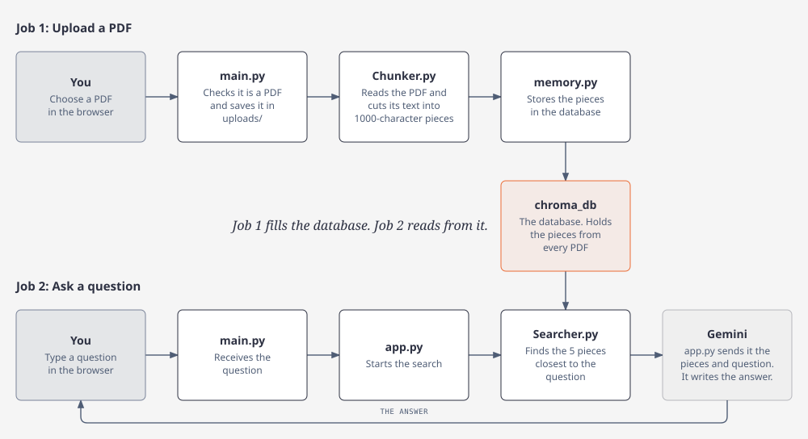

# PDF Chat

Upload your PDFs and ask questions about them in plain language. PDF Chat finds the parts of your documents that match your question and uses Google Gemini to write a short answer based only on that text.

It is a small, end-to-end **RAG (Retrieval-Augmented Generation)** app: a FastAPI backend, a ChromaDB vector database and a single-page web frontend.

## Features

- **Ask your documents.** Upload one or more PDFs, then chat with them.
- **Answers stay grounded.** Gemini answers only from the text it finds in your PDFs. If the answer isn't there, it says so instead of making something up.
- **Private per user.** Each browser gets its own random ID, and you can only search the documents uploaded from your browser.
- **Safe uploads.** Only real PDFs are accepted, and each user's files are saved in their own folder.
- **Readable answers.** Answers are shown as formatted Markdown, sanitized before display.

## How it works

The backend does two jobs. Uploading a PDF fills the database, and asking a question reads from it.



**Job 1: Upload a PDF**

1. The browser sends the PDF to `POST /PDFUpload` in **`main.py`**, which checks that it's a PDF and saves it to `uploads/<your-user-id>/`.
2. **`memory.py`** asks **`Chunker.py`** to read the PDF's text and cut it into 1000-character pieces.
3. **`memory.py`** stores the pieces in **ChromaDB** (`chroma_db/`), tagging each one with your user ID. ChromaDB turns each piece into an embedding, a list of numbers that captures its meaning, using a small model that runs on your own computer.

**Job 2: Ask a question**

1. The browser sends the question to `POST /chatbot` in **`main.py`**.
2. **`app.py`** asks **`Searcher.py`** for the 5 pieces closest in meaning to the question, searching only your own documents.
3. **`app.py`** sends those pieces and the question to **Gemini**, which writes the answer that is shown in the chat.

## Tech stack

| Part | Tool |
| --- | --- |
| API server | [FastAPI](https://fastapi.tiangolo.com/) + [Uvicorn](https://www.uvicorn.org/) |
| PDF reading | [pypdf](https://pypdf.readthedocs.io/) |
| Vector database | [ChromaDB](https://www.trychroma.com/) (default `all-MiniLM-L6-v2` embeddings) |
| Language model | [Google Gemini](https://ai.google.dev/) via `google-genai` |
| Frontend | Plain HTML, CSS and JavaScript ([marked](https://marked.js.org/) + [DOMPurify](https://github.com/cure53/DOMPurify)) |

## Project structure

```
.
├── main.py            # FastAPI app: the /PDFUpload and /chatbot endpoints
├── app.py             # Searches your chunks, then asks Gemini for an answer
├── memory.py          # Stores PDF chunks in ChromaDB
├── Chunker.py         # Reads a PDF and splits its text into chunks
├── Searcher.py        # Finds the chunks closest to a question
├── config.py          # Loads the Gemini API key from .env
├── frontend/
│   └── index.html     # The web app (upload + chat)
├── docs/
│   └── backend-map.svg
├── requirements.txt
└── .env.example       # Template for your own .env file
```

These are created when you run the app and are not committed to git: `.env` (your key), `uploads/` (your PDFs) and `chroma_db/` (the database).

## Getting started

### Requirements

- Python **3.12 or newer**
- A free Gemini API key from [Google AI Studio](https://aistudio.google.com/apikey)

### 1. Clone and install

```bash
git clone https://github.com/<your-username>/<your-repo>.git
cd <your-repo>

python3 -m venv venv
source venv/bin/activate        # On Windows: venv\Scripts\activate
pip install -r requirements.txt
```

### 2. Add your API key

```bash
cp .env.example .env
```

Open `.env` and replace `your-gemini-api-key-here` with your key.

### 3. Start the backend

```bash
uvicorn main:app --port 8001
```

The frontend expects the API at `http://127.0.0.1:8001`. The first upload can take a little longer because ChromaDB downloads its embedding model (about 80 MB) once.

### 4. Open the app

Open `frontend/index.html` in your browser, upload a PDF and start asking questions.

## API

Both endpoints need an `X-User-Id` header (any UUID). The frontend adds it for you.

| Endpoint | What it does |
| --- | --- |
| `POST /PDFUpload` | Upload a PDF (form field `file`) |
| `POST /chatbot?qna=...` | Ask a question and get an answer |

While the server is running, you can try both at `http://127.0.0.1:8001/docs`.

## Privacy

- Your PDFs stay on the computer running the backend.
- You can only search your own documents.
- To answer a question, the matching text and your question are sent to Gemini.
- There are no logins. If you clear your browser data, you lose access to your documents.

## Limitations

- Scanned PDFs (images only) can't be read.
- Uploaded files can't be deleted from the app yet.
- The document list in the page clears on reload, but the files are still searchable.
- CORS allows any origin. Restrict it before putting the app online.
